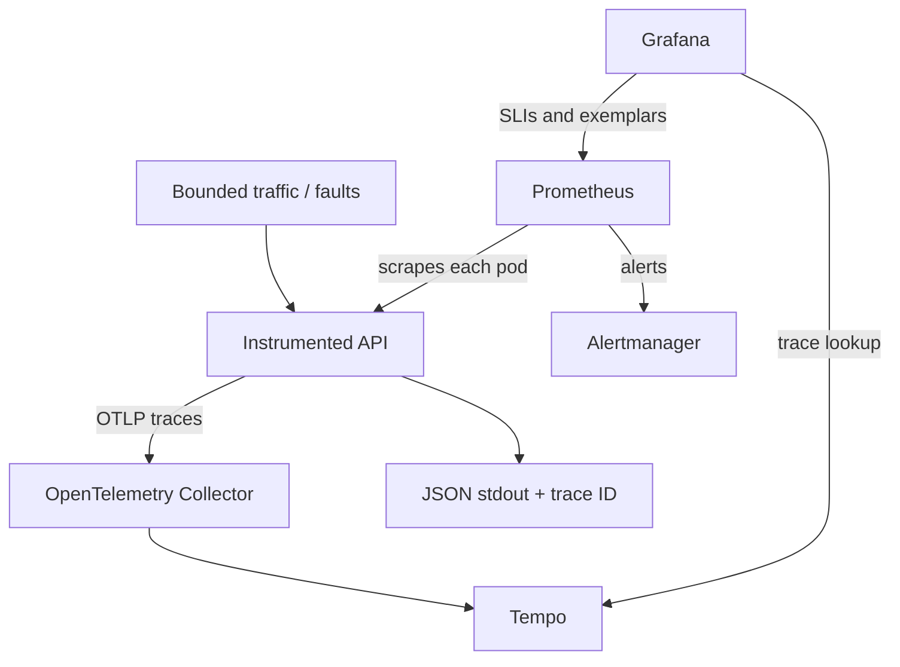

# Kubernetes SRE Observability

[](https://github.com/jdj333/kubernetes-sre-observability/actions/workflows/ci.yml)

A runnable incident lab by [James Jenkins](https://github.com/jdj333): instrument a service, define user-facing reliability objectives, detect error-budget burn, and follow a failing request from a dashboard to its trace.

The same stack runs with Docker Compose or in a dedicated local Kubernetes cluster. It includes a Python API, Prometheus, Alertmanager, Grafana, an OpenTelemetry Collector, and Tempo. All examples use synthetic traffic and fictional workloads.

## What this demonstrates

| Engineering skill | Working example |
| --- | --- |
| Application instrumentation | Bounded metric labels, latency histograms, OpenMetrics exemplars, W3C trace context, JSON logs |
| SLO design | Request-based availability and latency objectives, explicit denominators, 30-day error budgets |
| Actionable alerting | Multiwindow burn-rate rules, recovery checks, missing-target and no-traffic alerts |
| Incident diagnosis | Provisioned 12-panel dashboard, trace lookup, incident runbook and postmortem template |
| Kubernetes operations | Per-pod scrape discovery, namespace-scoped RBAC, resource limits, probes, non-root containers |
| Reliability validation | App tests, promtool scenarios, and end-to-end CI for both Compose and kind |

## Architecture



Metrics use the Prometheus client and are scraped directly. Traces use OpenTelemetry and pass through the Collector. Logs stay on stdout for `docker compose logs` or `kubectl logs`; this lab does not include a log database.

## Quick start: Docker Compose

Prerequisites: Docker with Compose v2, Python 3.10+, and Git. Allow approximately 4 GB of Docker memory. No cloud account or credentials are needed.

```bash
git clone https://github.com/jdj333/kubernetes-sre-observability.git
cd kubernetes-sre-observability
make up
make smoke
python3 scripts/traffic.py baseline --duration 600
```

`make up` generates an ignored `.env` with a random Grafana admin password. Grafana opens as an anonymous **Viewer**; changes to dashboards belong in source control.

| Interface | URL |
| --- | --- |
| Grafana dashboard | http://127.0.0.1:3000/d/sre-overview |
| Prometheus queries and alerts | http://127.0.0.1:9090 |
| Alertmanager | http://127.0.0.1:9093 |
| Sample API | http://127.0.0.1:8000/api/work |
| OpenMetrics endpoint | http://127.0.0.1:8000/metrics |

Wait for at least two scrapes before interpreting rates. The 30-day panels use **available history** until the stack has collected a full 30 days; they are not evidence of a completed 30-day SLO. No traffic produces an undefined SLI, not 100% success.

## Run an incident

Run one traffic mode at a time for a predictable fault percentage. Each fault mode generates a mix of healthy and faulty requests.

```bash
# 25% of requests return HTTP 503 for ten minutes.
bash scripts/inject-errors.sh --duration 600 --fraction 0.25

# Or: 25% of requests receive 800 ms of extra latency.
bash scripts/inject-latency.sh --duration 600 --fraction 0.25 --latency-ms 800

# Recovery: stop fault traffic, then supply healthy requests.
python3 scripts/traffic.py baseline --duration 600
```

Observe request rate, bad-request ratios, burn rates, and alert state. A request response and each JSON log contain a trace ID; use Grafana Explore → Tempo → Trace ID to find the request and its `simulated_dependency` child span. Prometheus exemplars also link to Tempo.

Alert timing depends on traffic history and the `for` duration. A fresh lab has shorter history than the query windows and can alert sooner. Use the [runbook](docs/runbook.md) for the investigation and [SLO specification](docs/slos.md) for exact semantics. Alertmanager groups and displays alerts locally; no email, Slack, or paging destination is configured.

Faults apply only to the request carrying the demo headers and never alter deployment state. Injection is disabled by default in application code and explicitly enabled in the lab manifests. Scripts accept only loopback URLs, reject redirects, cap duration/rate/concurrency, and exit on network errors. There is no reset endpoint to forget.

## Quick start: Kubernetes with kind

Additional prerequisites: `kind` v0.30.0 and `kubectl` compatible with Kubernetes 1.33. The script uses a named, dedicated cluster and an explicit context for every Kubernetes command.

```bash
bash scripts/kind-up.sh
bash scripts/port-forward.sh
```

In another terminal, run `make smoke` or the traffic commands above. Stop the Compose stack first if it already occupies ports 3000, 8000, 9090, or 9093.

The manifests use only built-in Kubernetes resources. They do not require Helm, a Prometheus Operator, or custom resource definitions. Prometheus discovers every API pod independently, so scaling replicas does not make a service load balancer hide metrics. Its Role grants only `get/list/watch` on pods in `sre-lab`.

```bash
# Inspect rendered configuration without deploying.
kubectl kustomize .

# Exercise per-pod discovery.
kubectl --context kind-sre-observability -n sre-lab scale deployment/sre-api --replicas=2
```

Port-forwarding a Service sends test traffic to one selected pod, while Prometheus still scrapes both. To test balanced client traffic across replicas, use an in-cluster load generator or a separately configured ingress.

## SLOs and alerts

| SLO | Eligible requests | Good requests | Rolling target |
| --- | --- | --- | --- |
| Availability | Completed `GET /api/work` with 2xx or 5xx | 2xx | 99.9% over 30 days |
| Latency | Same population | Duration ≤ 300 ms, regardless of status | 99% over 30 days |

Probe, metrics, unknown-route, and invalid-input 4xx requests are excluded. Availability and latency are evaluated independently, so a fast 503 consumes availability budget but not latency budget. Neither request SLI captures requests that never reach the app; the missing-target alert covers scrape loss, and production should also use external probes.

| Tier | Long / short window | Burn threshold | Pending period |
| --- | --- | --- | --- |
| Critical | 1 hour / 5 minutes | 14.4× | 2 minutes |
| Warning | 6 hours / 30 minutes | 6× | 5 minutes |

Both windows must breach. At constant traffic, the critical threshold consumes about 2% of a 30-day budget in one hour; warning consumes 5% in six hours. Budget panels can go negative when an objective is breached. There is no claim of a production SLA.

## Validation

```bash
python3 -m venv .venv
source .venv/bin/activate
pip install -r requirements-dev.txt
make test
make smoke  # Requires a running Compose or port-forwarded kind stack.
```

GitHub Actions runs application and script tests, Prometheus rule checks and scenario tests, Collector and Alertmanager validation, and a Compose/kind integration matrix. Integration checks real metric ingestion, rule evaluation, dashboard provisioning, and a trace traveling through the Collector into Tempo and back through Grafana. Failed jobs print component diagnostics.

## Repository map

```text
app/                      Instrumented Flask application
observability/            Prometheus, Alertmanager, Collector, Tempo, Grafana
k8s/                      Deployments, ClusterIP services, namespace, RBAC
kustomization.yaml        Shared configuration mounted into Kubernetes
scripts/                  Local setup, bounded faults, traffic, smoke verification
tests/                    Python tests and Prometheus scenarios
docs/                     SLO contract, diagnosis runbook, postmortem template
.github/workflows/        Validation and integration automation
```

## Scope and tradeoffs

This is an educational local lab. Host ports bind to loopback and Kubernetes services use ClusterIP. Internal OTLP traffic is plaintext and Grafana has anonymous read access. Use a dedicated local cluster: there are no NetworkPolicies, workload authentication, ingress TLS, or tenant boundaries here.

Compose retains Prometheus and Tempo data in named volumes. Kubernetes uses `emptyDir`, so pod replacement discards history. Prometheus retention is 31 days, but storage capacity is not sized for production. Tempo retention is 24 hours. One Gunicorn process with four threads keeps the in-memory registry correct; scale pods instead of adding workers without a multiprocess metrics design.

Before adapting this for production, add authenticated access, transport encryption, persistent storage/object storage, HA and capacity planning, secret management, external probes, real notification receivers, and image digest verification. Image and direct Python dependency versions are pinned for this lab, not a promise of current vulnerability status. Dependabot tracks Python, Dockerfile, and Actions dependencies; review Compose/Kubernetes image pins as well.

## Cleanup

```bash
make down  # Keeps Compose metric/trace volumes.
kind delete cluster --name sre-observability  # Removes this lab cluster and its data.
```

To intentionally discard Compose history too, run `docker compose down --volumes`.

## References

- [Google SRE: Alerting on SLOs](https://sre.google/workbook/alerting-on-slos/)
- [Prometheus rule unit testing](https://prometheus.io/docs/prometheus/latest/configuration/unit_testing_rules/)
- [OpenTelemetry Python exporters](https://opentelemetry.io/docs/languages/python/exporters/)
- [OpenTelemetry Collector to Tempo](https://grafana.com/docs/tempo/latest/set-up-for-tracing/instrument-send/set-up-collector/otel-collector/)

Licensed under [MIT](LICENSE).
